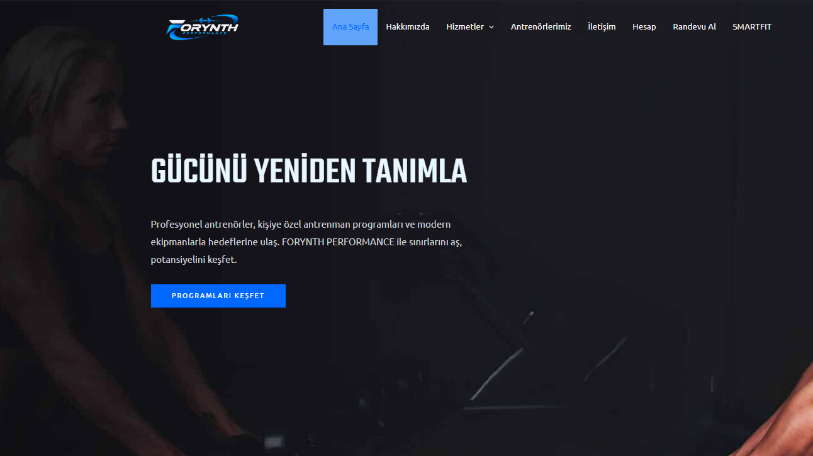
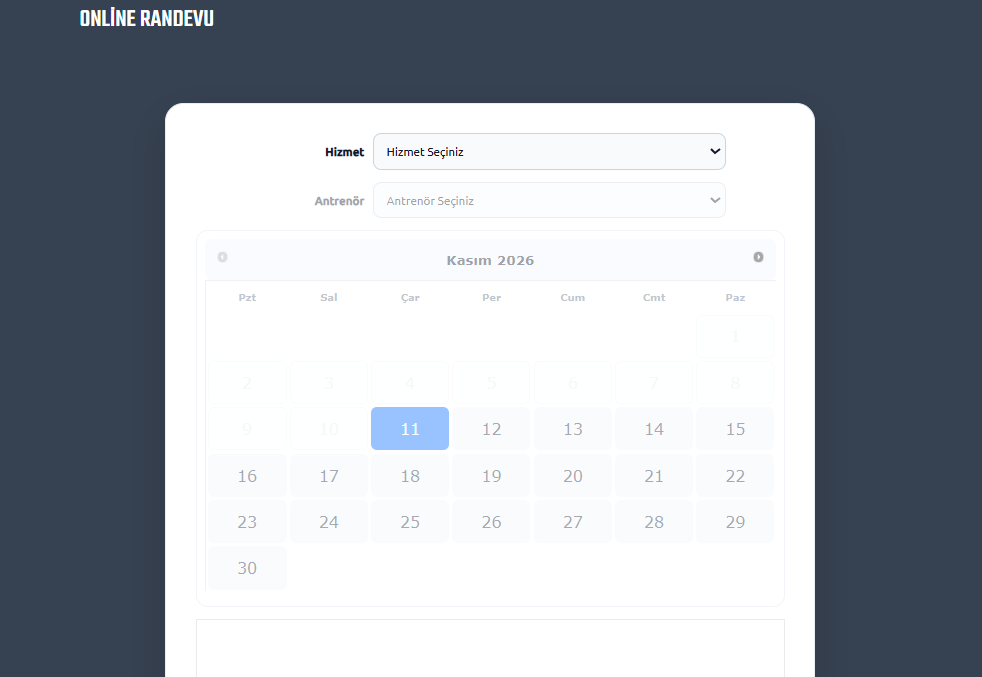
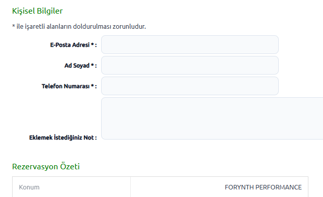
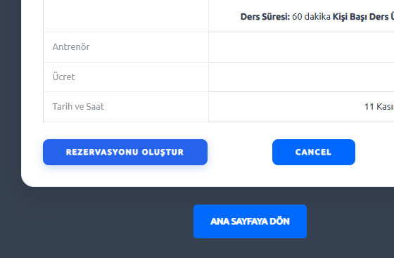
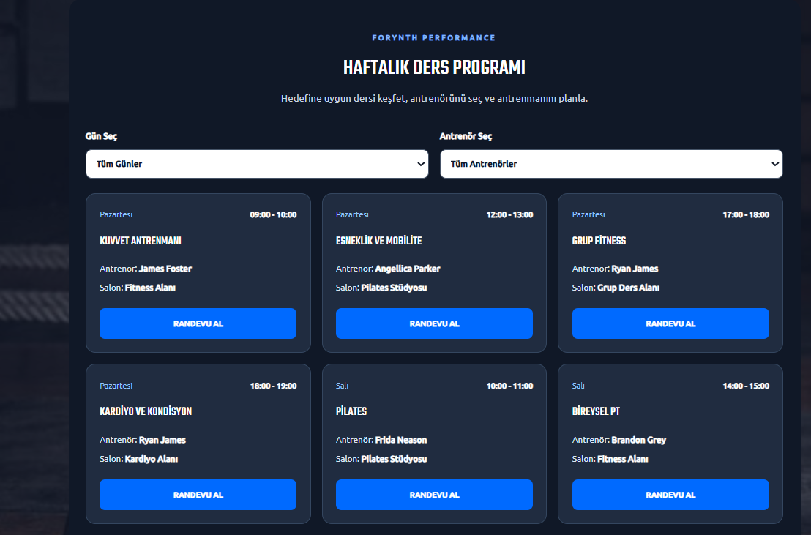
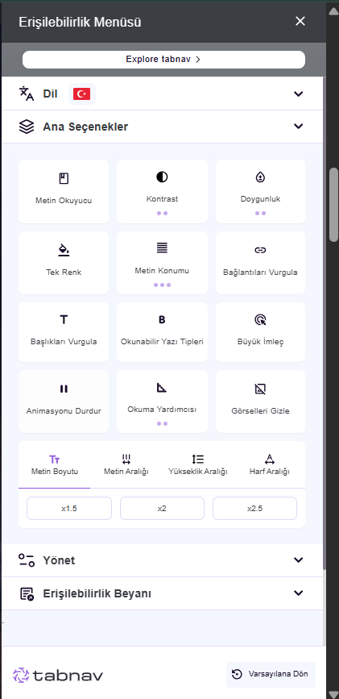

# 🏋️ FORYNTH PERFORMANCE

### WordPress Tabanlı Spor Merkezi Yönetim ve Online Rezervasyon Sistemi

FORYNTH PERFORMANCE; spor merkezi hizmetlerini dijital ortamda sunmak, kullanıcıların antrenman programlarını incelemesini sağlamak ve online rezervasyon işlemlerini kolaylaştırmak amacıyla geliştirilmiş bir web uygulamasıdır.

Proje; üyelik yönetimi, antrenör tanıtımları, bireysel ve grup antrenmanları, salon kiralama, haftalık ders programı, online rezervasyon ve kişiselleştirilmiş antrenman öneri sistemini bir araya getirmektedir.

---

## 🚀 Proje Özellikleri

### 🏠 Spor Merkezi Tanıtımı
- Modern ve duyarlı (responsive) web arayüzü
- Spor salonu, ekipman ve tesis olanaklarının tanıtımı
- Eğitmenlerin fotoğrafları ve uzmanlık alanları
- PT paketleri, hizmet açıklamaları ve seans ücretleri
- İletişim ve konum bilgileri

### 👤 Üyelik ve Kullanıcı Yönetimi
- Kullanıcı kayıt ve giriş sistemi
- Kullanıcı profili ve hesap bilgilerini düzenleme
- Üyelere özel kontrol paneli
- Kullanıcı rollerine dayalı erişim kontrolü
- Rezervasyon sayfasına giriş yapmadan erişimin engellenmesi

### 📅 Online Randevu ve Rezervasyon
- Hizmet seçimi
- Antrenör seçimi
- Uygun tarih ve saatlerin görüntülenmesi
- Rezervasyon oluşturma ve yönetici onayı
- Rezervasyon çakışmalarını önlemeye yönelik uygunluk kontrolü
- Türkçeleştirilmiş ve özelleştirilmiş rezervasyon arayüzü

### 🗓️ Haftalık Ders Programı
- Haftanın günlerine göre derslerin listelenmesi
- Antrenör bazlı filtreleme
- Derslerin başlangıç ve bitiş saatleri
- Dersin gerçekleşeceği salon bilgisi
- Rezervasyon sayfasına yönlendirme

Ders programı, özel geliştirilen WordPress shortcode yapısıyla oluşturulmuştur.

**Shortcode:** `[forynth_schedule]`

*Not: Haftalık ders programı şu aşamada PHP içinde tanımlanan ders verilerini kullanmaktadır. Rezervasyonların gerçek zamanlı olarak otomatik aktarılması henüz uygulanmamıştır.*

### 💪 SMARTFIT — Kişiselleştirilmiş Antrenman Öneri Sistemi

SMARTFIT, kullanıcıların belirlediği kriterlere göre haftalık egzersiz programları oluşturan özel bir modüldür.

Program oluşturulurken şu bilgiler kullanılır:

- Antrenman hedefi
- Deneyim seviyesi
- Haftalık antrenman gün sayısı

Bu bilgiler doğrultusunda kullanıcıya egzersizlerden ve dinlenme günlerinden oluşan bir antrenman planı sunulur.

### ♿ Erişilebilirlik

Farklı kullanıcı ihtiyaçlarını desteklemek amacıyla web sitesine erişilebilirlik araçları entegre edilmiştir.

- Yazı boyutu düzenleme
- Kontrast ayarları
- Bağlantıları vurgulama
- Görsel ve metin görünümüyle ilgili seçenekler
- Erişilebilirlik kontrol paneli

---

## 🛠️ Kullanılan Teknolojiler

| Teknoloji | Kullanım Amacı |
|---|---|
| WordPress | İçerik yönetimi |
| PHP | Sunucu tarafı geliştirmeleri |
| MySQL | Veritabanı yönetimi |
| HTML5 | Sayfa yapısı |
| CSS3 | Arayüz tasarımı |
| JavaScript | Dinamik işlemler ve filtreleme |
| Astra | WordPress teması |
| Spectra | Sayfa tasarımı |
| Ultimate Member | Üyelik ve kullanıcı yönetimi |
| Easy Appointments | Online rezervasyon |
| XAMPP | Yerel geliştirme ortamı |
| Visual Studio Code | Kod geliştirme |
| GitHub | Sürüm kontrolü ve dokümantasyon |

---

## 📁 Proje Dosya Yapısı

```text
FORYNTH-PERFORMANCE/
├── README.md
└── forynth-custom/
    ├── forynth-custom.php
    ├── includes/
    │   └── class-schedule.php
    └── assets/
        ├── css/
        │   ├── booking.css
        │   └── schedule.css
        └── js/
            ├── booking.js
            └── schedule.js
```

### Özel WordPress Eklentisi

`forynth-custom` klasörü, projeye özel geliştirdiğimiz işlevleri içermektedir.

- `forynth-custom.php`: Eklenti başlangıç dosyası, rezervasyon sayfası erişim kontrolü ve dosya yükleme işlemleri
- `class-schedule.php`: Haftalık ders programı ve WordPress shortcode
- `booking.css`: Rezervasyon sayfasının özel tasarımı
- `booking.js`: Rezervasyon arayüzündeki Türkçe metin düzenlemeleri
- `schedule.css`: Haftalık ders programının tasarımı
- `schedule.js`: Gün ve antrenör filtreleme işlemleri

---

## ⚙️ Kurulum ve Çalıştırma

Proje XAMPP kullanılarak yerel geliştirme ortamında hazırlanmıştır.

1. Apache ve MySQL servisleri başlatılır.
2. WordPress dosyaları yerel sunucu dizinine yerleştirilir.
3. MySQL veritabanı phpMyAdmin üzerinden içe aktarılır.
4. WordPress veritabanı bağlantı ayarları yapılandırılır.
5. Gerekli tema ve eklentiler etkinleştirilir.
6. FORYNTH Custom eklentisi `wp-content/plugins/` klasörüne eklenir.
7. WordPress üzerinden ilgili sayfalar ve rezervasyon ayarları kontrol edilir.

**Yerel adres:** `http://localhost/nova-fitness/`

Bu GitHub deposu, projenin özel geliştirme kodlarını ve dokümantasyonunu içermektedir. WordPress kurulum dosyaları ve veritabanı güvenlik nedeniyle bu depoda paylaşılmamaktadır.

---

## 🔒 Güvenlik

- Giriş yapmamış kullanıcıların rezervasyon sayfasına erişimi sınırlandırılmıştır.
- Kullanıcı yetkileri WordPress rolleri üzerinden yönetilmektedir.
- Gizli yapılandırma bilgileri ve kullanıcı verileri herkese açık depoda paylaşılmamaktadır.

*Not: Rezervasyon işlemlerinin sunucu tarafındaki yetki kontrolünün ayrıca doğrulanması gerekmektedir.*

---

## 📌 Geliştirme Durumu

**Tamamlanan başlıca özellikler:**
- Spor merkezi web arayüzü
- Üyelik ve giriş sistemi
- Üye kontrol paneli
- Online rezervasyon
- Haftalık filtrelenebilir ders programı
- SMARTFIT antrenman öneri modülü
- Erişilebilirlik paneli

**Planlanan veya test edilmesi gereken geliştirmeler:**
- Google Calendar entegrasyonunun doğrulanması
- Ders programı ile rezervasyonların dinamik entegrasyonu
- Günlük rezervasyon limitinin incelenmesi
- Sunucu tarafı rezervasyon erişim kontrolünün doğrulanması

---

## 📄 Proje Hakkında

Bu proje, WordPress altyapısının özel PHP, CSS ve JavaScript geliştirmeleriyle genişletilebileceğini göstermek amacıyla hazırlanmıştır.

FORYNTH PERFORMANCE, spor merkezi tanıtımını kullanıcı yönetimi ve rezervasyon işlevleriyle birleştiren uygulamalı bir web geliştirme projesidir.

---

## 📸 Proje Ekran Görüntüleri

### 🏠 Ana Sayfa

FORYNTH PERFORMANCE web sitesinin ana sayfası.
Modern arayüzü ile spor merkezi, hizmetler ve antrenman
olanakları hakkında bilgi sunmaktadır.



---

### 📅 Online Rezervasyon Sistemi

Kullanıcılar hizmet ve antrenör seçerek uygun tarih
ve saatleri görüntüleyebilir, online rezervasyon
talebi oluşturabilir.

#### Rezervasyon Ekranı



#### Tarih ve Saat Seçimi



#### Rezervasyon Onay Ekranı



---

### 🗓️ Haftalık Ders Programı

Haftalık ders programında kullanıcılar antrenmanların
günlerini, saatlerini, antrenörlerini ve salonlarını
inceleyebilir.

Gün ve antrenör filtreleriyle istedikleri dersleri
kolayca görüntüleyebilir.



---

### ♿ Erişilebilirlik Menüsü

Web sitesinde farklı kullanıcı ihtiyaçlarını
destekleyen erişilebilirlik araçları bulunmaktadır.

Kullanıcılar yazı boyutu, kontrast ve diğer
görünüm ayarlarını ihtiyaçlarına göre düzenleyebilir.



---

